# 2DISO *SHIFT* — devlog

A GitHub Game Off 2026 entry (theme: SHIFT). Designed and directed by Benjamin Campbell (BDC / GRiDDiM), built with Claude as the programmer. Every line of art and every sound is generated by code in this repo.

## Backstory — how we make games

2DISO SHIFT was not built from a standing start. It sits on top of a way of working that BDC has been putting together all year.

### The Griddim bootstrap
Griddim is a small network of sites that all share one shell. The rule for the shell is written down as a standard called the bootstrap, and it fits in one line:

**Modules own screens. Agents operate on screens.**

Every site on the network has the same seven parts: a global header, a site header, a left bar of modules, a workspace that shows the active module, a right bar of agents, a site ticker and a global footer. A new site starts from one sentence ("integrate this domain into the network, concept: ...") and the bootstrap fills in the rest, so nobody has to explain the architecture twice, to a person or to a model.

### ArcadeGridz: the site and the app
ArcadeGridz is the arcade built on that shell. A game there is a module that mounts into the workspace through a small contract:

- one mount function that hands back pause, resume and destroy handles
- a shared controller layer, so a game listens for a handful of keys and every pad just works
- a system menu on Start + Select, the same in every game
- an agent panel on the right that shows live stats and Pause / Idle buttons
- shared leaderboards, with runs tagged verified, assisted or cheater

There is also a native Windows launcher, the ag app. It syncs its catalog from the site, so adding a game to the site adds it to the app with no app update.

A game counts as ready when it plays on keyboard, controller, phone and tablet, has its own menus with a real exit, pauses itself when it loses focus, and has an idle mode. Ready games are tagged BETA. Most of the catalog began as BDC's old GameMaker projects, rebuilt with the original source as reference rather than as a blueprint.

The house rules for game code came out of that work, and this game follows them: the simulation is pure and seeded with a fixed 60 Hz step, players are an array even when there is one, and all input passes through one object per player. That is why the same code can run the title demo, idle mode, a headless test and, later, multiplayer.

2DISO SHIFT is a standalone game first. The jam build runs from a single HTML page. A thin adapter file is all that connects it to ArcadeGridz.

### Different AI models for different jobs
BDC directs and the models build. Different models have ended up with different jobs:

- **ChatGPT and Codex** built the original network shell, the first version of the arcade site and the on-site agents, and started the Windows launcher.
- **Claude** builds and maintains the games, and took over the launcher. This game was scoped in a first pass with one Claude model and built with a newer one.
- **Small local models** run the on-site agents day to day, with the larger models as a fallback.
- **An autopilot inside the game** is the tester. It plays every level headless after each change.

What makes this work is written handoff. Every session ends with notes on what changed, what version is live and how to roll it back, so the next model, or the next session, starts from facts instead of guesses.

BDC's side is the part a model cannot do: deciding what the game is, playing it, and saying what feels wrong. Most of the prompts quoted below are one or two lines long.

## Day 1 — Wed 11 Nov 2026

### 1. The idea
> "what do you think about this game jam? can we make a revision of 2diso called 2diso -shift- for this?"

The original 2DISO flipped between a 2D and an isometric view on a timer. The jam theme was SHIFT, so the fit was obvious. Two decisions came out of the first exchange:

> "i would want a brand new game ... not just 2diso reskinned or renamed. and yes shifting between views with an action instead of timer was what i was thinking too."

- Checked the jam rules: source must be public on GitHub, existing code and AI help are allowed, but the game should be made for the jam.
- Created the public repo and pushed a README and MIT license.

### 2. The design prompt
> "i also want it to shift between an over the shoulder view ... and a birds eye vertical rail view ... so thats 4 different views to shift between."

This one message set most of the game: four views, a Griddim / ArcadeGridz splash and a ship swoop into the title, neon wireframe arcade art ("that way you dont have to generate sprites"), forced reasons to change view, hidden warps to bonus levels, the planet order (Earth, Mars, Jupiter, Planet X), an upgrade bar where each pickup moves a highlight and you choose when to spend it, drones that survive death, and a random god mode drop.

Follow-ups locked the controls:
> "shift should be controlled by L and R buttons. you kind of barrel roll into the views."
> "A can shoot. Y is bombs. X modifies drone behavior."
> "use select then to pick the upgrades and put a map menu item in the pause menu instead"

### 3. The core rule
The design problem was making four views matter. The answer became the whole game:

**What a view flattens does not exist for collisions.**

- SIDE ignores left/right: a full-height skyscraper is a wall, a deck is something to duck.
- TOP ignores altitude: a deck is a wall, a skyscraper is something to steer round.
- ISO and CHASE keep all three axes: a wall with one hole needs them.

One collision function with a per-view axis mask gave every obstacle a different meaning in every view, with no special cases.

### 4. Build order, first pass
1. `font.js`: a stroke font drawn as line segments, so there are no font files.
2. `game.js`: pure seeded simulation at a fixed 60 Hz, players as an array, no DOM.
3. An autopilot that plans against predicted obstacle positions. It runs Idle Mode and the title demo, and it plays every level headless as the test suite.
4. `render.js`: four projections of the same 3D world, blended with a 360 degree roll for the shift.
5. `audio.js`: all sound synthesised with Web Audio.
6. `ui.js`: keyboard, controller and touch input, intro, menus, HUD, saves.

Bugs worth remembering:
- The autopilot flew into walls because it assumed it would travel in a straight line to its target, while the ship really moves at full speed on both axes at once. Predicting per axis fixed it.
- Key taps shorter than one frame were lost. Input now latches a press until it has been read.

### 5. Sound and story
> "dont forget high score and combo systems, floating combat text, announcer voiceover, fanfare for pickups and things, a toast upon level completion, liquid dnb music, lofi during menus ... storyline about defending earth from a cosmic shift"

- Liquid drum and bass in flight, lo-fi on the menus, a darker roller for bosses, all sequenced in code.
- Announcer through the browser's speech voice.
- Story: a rift from Planet X is folding reality one world at a time.

The Earth demo went live on ArcadeGridz the same morning.

### 6. First playtest, second pass
> "very cool ... in many ways its better than our original 2diso. it could use some tweaks"

The feedback list, and what changed:
- **"weapon upgrades are a little boring ... add wave weapon and a snaking lightning thing"**: SPEED left the bar. New bar: DRONE, SPREAD, LASER, WAVE, BOLT, MISSILE, SHIELD, ???. Each weapon has named tiers. BOLT snakes round the screen and then homes in.
- **"the starting weapon should shoot a bit slower"**: every weapon starts slow and speeds up with its own level.
- **"god mode should do that super hyper beam thing"**: god mode fires a rainbow hyper beam, maxes every weapon and fills out five drones; the borrowed drones leave when it ends.
- **"tap it and it cycles between slow speed, default speed, and thrusted speed"**: B is now a three-speed gear, and SLOW is the default.
- **"it should give you a little more time to shift"**: the world slows while you roll, the roll is quicker, hints come earlier.
- **"walls that spawn during the first boss fight need more gridlines"**: boss sheets are dense grids, the safe gap is framed in green, and they charge for longer.
- **"add a altitude bar"**: left edge of the HUD, with the blocked heights ahead in red and the way through in green.
- **"the warp needs to be more hidden"**: each warp can only be reached from one view, and now leads somewhere.
- **"do all the levels including bonus levels ... unique enemies/obstacles/bosses"**: Mars (geysers, fire arcs, magma worms, alien stone heads, THE COLOSSUS), Jupiter (lightning chains, storm walls, wraiths, THE EYE), Planet X (tentacles, membranes, spores, THE SHIFTER), and bonus stages on the Moon, the Sun, the Asteroid Belt and Pluto.
- **"the hyperspace segway ... should swap through all the views"**: every level opens by rolling through TOP, CHASE and ISO before handing over in SIDE.
- **"more neon tube light glows"**: every line is drawn as a tube: wide halo, glow, bright core.
- Level select from the solar map, for testing.

### 7. Second playtest, quick fixes
> "you made the walls that spawn during first boss actually harder to see not easier"

True. The new boss walls only drew their top and bottom faces, and in the 2D side view those are edge-on, so each wall collapsed into one line. Every face is now cross-hatched and the gap is boxed in green with chevrons.

> "mars boss should be more like an alien easter island type statue thing ... with smaller heads scattered throughout the level as enemies"

- The Mars boss is now THE COLOSSUS, a giant alien stone head rising out of the ground. Its attacks: eruptions under you, a rising lava tide and falling ash, then rings of fire.
- Smaller stone heads run through the level: sentinels planted in the ground that lob fire, floating heads that stare you down, and statue pillars to weave between.
- Sun bonus: the shadow lane is a dense blue hatch with bright rails, the screen glows hotter as you cook, and the flares are fans of wavy tendrils.
- BOLT has a much longer lightning tail.

### 8. Solid shapes and the arenas
> "add textures/gradient fills / shading / shadows to obstacles so we can see if it looks better or worse"

- Obstacles can be drawn solid: dark shaded faces, a ground shadow, and the lines behind them hidden so the scene reads cleanly. It is an option (SOLID OBSTACLES) so both looks can be compared.

> "can we weave in an arena between levels that you have to clear a few waves in ... that would match the theme of the level you just cleared"

- After every boss there is now a bonus arena: GRID ZERO, THE CRUCIBLE, EYE OF THE STORM and THE HEART. Free movement inside a walled grid, auto-aim at the nearest target, five waves and a champion.
- SHIFT still matters: L/R flips the arena between TOP and ISO, and the white enemies can only be hit in ISO.
- Each arena carries its planet's hazard (geysers on Mars, lightning on Jupiter, and so on). Losing your shield ends the bonus without costing a life.

### 9. The "make it more impressive" pass
> "do you have any other suggestions for improvements or features for the game to make it more impressive?" ... "ok do all that stuff."

Nine ideas went on the list and all nine went in, plus one more from Benjamin.

- **Perfect Shift.** Roll out of the way of something that was about to hit you and the fold bites back: a shockwave, a few seconds of overdrive and a score bonus. The theme is now the skill.
- **Boss finishers.** A dying boss comes apart in slow motion while the camera rolls through all four views.
- **Twin-stick arenas.** Right stick or mouse aims in the arenas. Auto-aim stays as the fallback, so a pad without sticks still works.
- **A track per planet.** Earth keeps the liquid roller, Mars gets a heavy half-time stomp, Jupiter fast arpeggios, Planet X a detuned whole-tone crawl, plus arena and bonus tracks. All still synthesised.
- **Medals and ranks.** Six medals per planet (clear, no ships lost, untouched, warp found, chain 50, three perfect shifts) and a rank from D to SS, shown on the solar map.
- **Daily Run.** One seed for everybody each day, with one helpful and one hurtful twist picked from the date. No continues.
- **Best-run ghost.** The simulation is deterministic, so a run is just a seed, a loadout and the inputs. Your best run of each planet flies next to you as a ghost.
- **Screen effects.** Colour split on shifts, extra shock rings on big kills, an optional CRT filter.
- **Two-player co-op.** Two ships, one shared upgrade bar. Player one on keyboard, player two on a controller (or two controllers).

> "we can also do rivet-9 assist toggle too" ... "it will be cool to see what rivet 9 looks like when he shift perspectives before we do"

- **RIVET-9 assist.** RIVET-9 is the ArcadeGridz house AI. Switch him on and he flies as your wingman with a light gun. Runs with him are tagged ASSISTED. The first version had him roll into the next view before you did, drawn in that view.

> "forget having rivet 9 switch perspectives before us it looks funky and illogical lol. just have him do it when we do."

- He now rolls when you roll.
- **Weak spots.** Every boss core carries a hatched, pulsing gold target when it can be hurt and a dim red cross when it is shielded.
- **Easier to read shots.** The main gun fires thicker bolts, the laser has a wide glow, and enemy bullets are bigger spinning rings with a white core and a tail.
- **A further horizon.** Buildings, walls and other scenery are placed much further out and fade in, so nothing pops up in your face.

### 10. Third playtest
> "tone down the speed on the obstacles spawning on the first boss again ... if a upgrade is maxed out it should skip it ... i still cant seem to get the warp to work"

- **First boss, slower again.** OVERSEER's walls come about a third less often, charge for longer and leave wider gaps. Its bullets and thrown gates are slower too.
- **Three ranks per weapon.** SPREAD, LASER, WAVE, BOLT and MISSILE now max at 3 instead of 5. The weak early ranks are skipped, so rank 3 is still the full effect. Drones go up to 6. Boss health went up to match.
- **The bar skips what is maxed.** A pod never lands the highlight on a full slot.
- **Pods are gold and blue.**
- **God mode is one beam.** A single thick hyper beam that fires on its own in explosive pulses.
- **Warps you can actually take.** Each warp now fades in during the calm opening stretch of a level and hangs in front of you for about fifteen seconds before it fades out. In the flat views it is only a flickering sliver. Roll into CHASE view and it opens into a ring you can fly through.
- **Missiles you can see.** Finned rockets with smoke trails, a blast on every hit.
- **Menus.** Holding a button no longer presses a menu item over and over. SAVE AND QUIT now saves the exact spot instead of the last checkpoint.

### 11. Fourth playtest: every planet its own
> "each boss needs its own unique mechanics ... the levels need more of their own unique level themed mechanics too. not just giant boxes that get in the way"

- **Bosses stop sharing tricks.** The grid walls and thrown gates now belong to OVERSEER alone.
  - THE COLOSSUS ends with widening rings of fire that have one gap.
  - THE EYE is new from top to bottom: lightning that walks down the lane behind warning rings, a stare that locks onto your height and fires, a cyclone that drags you in while spiral arms of sparks sweep the deck, and storm orbs that circle the pupil and soak up shots.
  - THE SHIFTER throws walls of mutant blobs you have to burst, and rows of tentacles that erupt along whole lanes.
- **The camera pulls back for bosses.**
- **Earth:** neon billboards to shoot down, freight lifts riding between the skyways, blinking laser fences, cross traffic between the towers, and a second, faster stream of hover traffic with buses.
- **Mars:** rivers of lava that wander across the floor, lavafalls that pour and stop, basalt boulders to blast, boulders that roll.
- **Jupiter:** drifting fog banks, ammonia ice that grows across the one open lane, wandering tornadoes, floating storm buoys that shoot.
- **Planet X:** blob walls to burst, spore pods that pop into rings of acid, long tentacles that whip right across the forest.
- **Upgrade bar:** MISSILE and SPREAD swapped places, so the screen does not fill with spread shots early.
- **A shorter title menu.** PLAY, OPTIONS, HIGH SCORES, DEVLOG, EXIT GAME. Continue, New Game and Co-op live under PLAY. The solar map is still in the pause menu. The Daily Run is shelved.
- **The map before every hop.** Going to the next planet, into a bonus stage or back out of one, the solar map comes up first and the ship flies from where you are to where you are going. Then hyperspace.
- **Speed.** Jupiter and Planet X were dropping frames. Faint lines, sparks and smoke no longer get the expensive glow passes, and the game now steps its own quality down if frames run long.

### 12. Fifth playtest
> "add a bonus that affects rank based on how fast you beat it because maybe sometimes people are changing their speed"

- **Time counts.** Every planet has a par time. Beat it for a FAST CLEAR medal (a seventh medal, so the top rank is now SSS), and the faster you finish the bigger the time bonus. Flying the whole level at slow speed will not make par.
- **Progress bar.** A bar under the view tabs shows how far through the level you are, with the checkpoints marked.
- **The ship leans.** It banks when it slides sideways and noses up or down when it climbs or dives.
- **Weapons grow differently.**
  - LASER is one beam that gets thicker and hits harder with each rank, instead of extra rows.
  - MISSILE keeps two up front and adds rockets out of the back: two at rank 2, four at rank 3.
  - SPREAD covers your tail with two rear shots at max rank.
  - BOLT fires one bolt at a time, faster with each rank.

### 13. Sixth playtest
> "those box looking obstacles dont really make any sense in any level except the first one. you need to improvise different shapes and landscapes for the other levels"

- **No more crates off Earth.** The same obstacles are now drawn as ragged rock outcrops on Mars, scalloped cloud banks on Jupiter and quivering slabs of tissue on Planet X. Earth keeps its buildings.
- **More to shoot.** Every planet has roughly half again as many enemy waves, with divers between the flights.
- **A wider view.** The whole game is zoomed out a notch, and bosses pull the camera back further still.
- **The Eye's beam makes sense now.** It turns to follow you, holds still for a moment, then fires one big beam straight out of its pupil.
- **Lightning chains read in every view.** Seen end-on in the flat views they used to be a dot. Now they crackle.
- **Solid bosses.** Each boss has a shaded body behind its wireframe.
- **The shield hugs the hull.** One outline around the ship per layer, up to three.
- **Mars, again.** The lavafalls are thick, rippling curtains now, there are more rivers of lava, and THE COLOSSUS was re-cut so it reads as a giant stone head from every side: flat top with a topknot stone, a heavy brow shelf, a long nose, pursed lips, a jutting chin, long ears and buried shoulders.
- **Pods always pay.** Buying anything is worth 500 points, so pods still matter when everything is maxed.
- **A lost ship takes its weapons with it.** Drones stay, the guns start over. It was too easy to max everything by the middle of the second planet and never look back.

### 14. Seventh playtest: busier, wider, easier to read
> "the levels should be really busy but with enough time to react to everything"

- **Wider and taller.** The lane is a little wider and higher, and the camera sits further back again, in levels and in boss fights.
- **Far backgrounds.** Every planet has a distant layer now: a lit skyline with searchlights on Earth, volcano ranges with smoke plumes on Mars, drifting cloud belts and a great storm on Jupiter, swaying stalks with eyes on Planet X. Plus a moon or neighbouring world in every sky.
- **Earth looks like a city.** Buildings have lit windows and blinking masts. The skyways are truss bridges with running lights.
- **More of everything.** More enemy flights on every planet, small things to blast in the gaps, and ground troops: tracked guns on Earth and Jupiter, legged crawlers on Mars and Planet X, on the floor and sometimes the ceiling.
- **Missiles hug the walls.** They are no longer homing: one goes up and one goes down, then they run along the ceiling and the floor. In top view they run along the side walls. That makes them the answer to ground troops. The bolt is still the homing weapon.
- **More time to shift.** The call to change view comes earlier, nothing solid sits around a change of view, and if the view you need is two rolls away a single press takes you straight there. The L or R that gets you there lights up.
- **Boss walls fade in.** They start as a ghost and firm up gradually, and only blink in the last moment.
- **Catching up.** Losing a ship drops a few pods (more in a boss fight), and bosses throw a pod now and then.

### 15. Arenas and minibosses
> "the in between level bonus arena can be zoomed out quite a bit more and the arena made larger and instead of autoaiming it should shoot the direction you are facing as you move around"

- **A bigger arena, seen from further back.** The floor is about twice the area and the camera pulls well back. The waves are bigger to match.
- **You aim by flying.** The guns fire the way the ship faces, and it faces the way it moves. A right stick or the mouse still aims on its own if you have one.
- **A miniboss ends every arena.** GRID WARDEN patrols a square circuit sweeping four rotating streams. STONE ELDER marks where you stand, leaps there and lands in a ring of fire. THUNDER BLOOM drifts after you trailing spiral arms and calls lightning down. BROOD MOTHER hatches spores and spits fans of acid, faster as she weakens.
- **A miniboss ends every warp stage too.** LUNAR SENTINEL, SOLAR FLARE, THE MOTHER ROCK and FROST WARDEN. The stage only clears once it is gone.
- **Minibosses scale with you.** They are as tough as your guns are strong.
- **Clearing every wave pays more:** 15,000, on top of 5,000 for the miniboss. Dying in an arena still only ends the arena.
- **Hover traffic you can read.** On Earth the cars are colour-coded by height (green low, yellow middle, pink high), each one drops a line to a shadow on the ground, and the altitude meter shows the traffic ahead at its height. There are also about twice as many rows of it.

### 16. An ending, a credit roll, a loop, achievements and target order (r22)
BDC beat THE SHIFTER and nothing much happened. This revision gives the game an end, and a reason to keep going.

- **A real ending.** Planet X folds shut, the worlds you saved come back one at a time and the ship flies home. Then something stirs past Pluto.
- **Planet X now has its arena too.** THE HEART and the BROOD MOTHER come after THE SHIFTER, and the ending follows them.
- **Movie credits.** They roll slowly up the screen while the ship and RIVET-9 swoop through in wide figure-eights. Hold the button to speed them up.
- **Loop the game.** After the credits you can start again at Earth with every upgrade and your whole score. The save remembers which loop you are on.
- **Achievements.** Thirty of them, with their own entry on the title menu. They are kept on your device, and idle mode never unlocks them.
- **Target order.** Shoot one of a wave and the next one gets a target on it. Finish the whole wave in that order for a bonus of 300 a head.
- **Calmer missiles.** Smaller rockets, about half as often, less smoke, and never more than two out of the back. Each one hits harder to make up for it.

### 17. Loops that bite back (r23)
BDC's order: loop 2 significantly harder, loop 3 extremely difficult, loop 4 borderline impossible.

- **Every loop:** enemies are tougher (1.7, 2.6, then 4 times the health), their shots are faster, everything that flies now shoots, and it shoots back when it dies.
- **Hunters.** Red divers come at you all level long, more often each loop.
- **The scroll speeds up:** 15, 30, then 50 percent faster.
- **Bosses shoot at you too,** in wider fans each loop, on top of their own attacks.
- **Shields fade.** On loop 3 one hit strips every layer. On loop 4 shields do nothing.
- Past loop 4 the enemy just keeps getting tougher.

### 18. The wave is a wave (r24)
- **One wave, not several.** The wave weapon is now a single stream that snakes out of the ship along a sine curve, drawn as a glowing ribbon with a white-hot core and a trail of sparks.
- **Upgrades wind it up.** Each rank tightens the frequency, swings it wider and hits harder, and the colour climbs from cyan to violet to hot pink. No extra waves above or below the ship.
- It still passes through walls, and it ripples slowly so the curve never sits still.

### 19. Clean results screens (r25)
- GAME OVER and the clear screens now hide the HUD, so nothing overlaps the results. The level keeps running behind them, a little brighter than before.

## Day 2 — Thu 12 Nov 2026

### 20. Enemies you can watch die (r26)
BDC's note: everything was dying in one shot before you even noticed it.

- **Twice the health** on every ordinary enemy. Bosses and minibosses are unchanged.
- **Health bars** appear over anything that is being hit and fade a moment later.
- **Damage numbers** float off whatever you are hitting, in small batches so they stay readable. Score numbers still float up on a kill.
- **A wider view again.** The camera sits further back in levels, and further still for bosses and arenas.

### 21. Tougher still, a slower pace and a fourth speed (r27)
- **Enemy health scales with your guns.** Doubling it was not enough once the weapons were built up, and a flat four times starved a fresh ship of kills and pods. So ordinary enemies now start at 1.6 times their old health and climb as you upgrade: about four times by mid-game, just over five at full power.
- **The levels move slower,** and there are four speeds now: SLOW, CRUISE, FAST and TURBO. Slow is about a sixth slower than it was; turbo is the old top speed. Par times are longer to match.
- **Changing speed is called out.** SHIFTING UP or SHIFTING DOWN shows over the ship with the new speed, and the announcer says it.

### 22. Traffic from behind, and a building site (r28)
- **Hover traffic is a CHASE section now.** BDC found it far more fun from behind the ship than from the isometric view, so the level calls for CHASE there.
- **A construction zone takes the ISO slot on Earth.** Half-built girders at every height, crane loads swinging across the lane on their cables, crate stacks to shoot through for gems and pods, and turrets on the ground. It sits between the firewall gates and the traffic, so the level is a little longer and its par time went up to match.

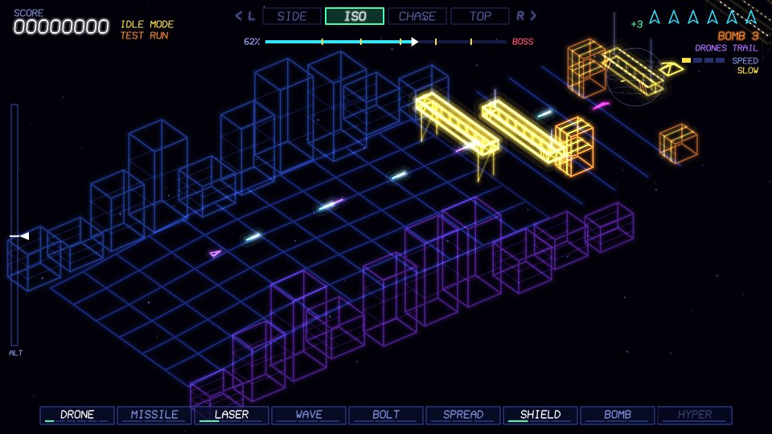

### 23. Room to fly, a kinder hitbox, and things that look like what they are (r29)
- **The ship can fly much further forward.** The forward limit moved out by two thirds, and bosses hold further back near the edge, so there is more room to read their attacks.
- **A smaller hitbox.** Only the hull counts now. Wing tips and the tail pass through things, so a car you have already cleared no longer clips you from behind.
- **Hits flash red.** Enemies and bosses blink red for a split second when a shot lands.
- **Earth's obstacles are drawn as what they are.** Hover cars are wedges with a glass canopy, headlights, tail lights and hover pads; buses are long slabs with a row of windows. Girders are yellow I-beams with rivets and hazard stripes, slung on cables or stood on posts. Cranes are lattice masts with a cab, a jib out over the lane and a counterweight; their loads hang on four slings and a hook. Crates have straps, and the wider towers get a rooftop pad.
- **The Sun stage has solar satellites.** The shade lanes are now the panels of satellites, each with a gold body, a dish and antennas.
- **Solar flares.** Big bright prominences loop up off the surface and whip across the lane, five in the first half and four in the second.
- **A fix on the Sun.** The heat kept climbing during the miniboss, after the last shade had gone, so the stage could end there through no fault of yours. The heat now stops once the miniboss arrives.

### 24. Nothing off Earth is a box (r30)
The second half of BDC's note from r29: smoother, more organic shapes on the other worlds.

- **Mars, Jupiter and Planet X.** Every plain obstacle is now drawn as a rounded body with a flat foot where it meets the ground or the roof: chamfered boulders with facet lines on Mars, scalloped cloud banks on Jupiter, bulging tissue that breathes on Planet X. Seen from above they are rounded outlines with an inner contour, not rectangles.
- **Asteroids and boulders** use a new lumpy twelve-point rock in place of the old diamond, and Mars boulders lost the square behind them.
- **Ice is cut stone.** Small ice blocks are irregular gems with facets, the Pluto shelf is a jagged sheet with cracks, and Pluto's spires are six-sided crystal shafts drawn to a point.
- **Bigger solar flares.** Wider strands, thicker glow, a slower sweep and a bigger hitbox to match in the first half of the Sun stage.

### 25. Centred views, lava that crosses your path, and arenas with a floor worth looking at (r31)
- **The view is centred again.** Pulling the camera back had left dead space at the bottom of the top-down view and down the left of the side view, most obviously in the arenas. Each view now zooms out from its own anchor, so the field sits between the HUD and the upgrade bar. The side view also pulls back a little less than the others.
- **Mars lava rivers flow across the lane.** They are wide, they stream sideways, and they no longer block. Instead the lava drags the ship to a crawl and fills a heat meter: cross one at the slowest speed and you overheat and take a hit. Shift up, or dash forward, and you get through with heat to spare.
- **Arena floors belong to their planet.** Earth is a circuit board with pulses running down the traces. Mars is a cracked crucible with glowing fissures, lava at both ends and braziers in the corners. Jupiter is a slowly turning storm spiral ringed with cloud. Planet X is a beating heart with veins running out to eye stalks.

### 26. The real logos (r32)
- The opening GRiDDiM and ArcadeGridz screens now show the actual logos when their image files sit beside the game (`src/logo-griddim.png` and `src/logo-arcadegridz.png`). On ArcadeGridz they do. Where the files are missing the game falls back to the drawn versions, so nothing breaks.

### 27. A sleeker font, shots that stop, a leaner gun, and worlds with less grid (r34)
- **The font.** Every corner of every letter is now rounded and the whole face leans slightly, so it reads as bent neon tube instead of calculator segments. The zero lost its slash.
- **Hits keep flashing.** Enemies and bosses strobe red while they are under continuous fire, where before they just stayed red.
- **Shots stop at what they hit.** Bullets, the laser, bolts and missiles are all spent on the first enemy or obstacle in their way. Only the wave and the god-mode pulse still pass through. The laser and the main gun hit harder to make up for it.
- **The main gun fires one bullet.** SPREAD now upgrades it: three ahead, then three ahead and one behind, then three ahead and three behind.
- **Mars has ground, not a grid.** Cracked, uneven terrain with rocks and craters, in the level and in its arena.
- **A cave on Mars.** A new ISO section between the fire arcs and the magma tubes: rock spikes rising from the floor and hanging from the roof, pillars, and rocks that let go of the ceiling as you get near and smash on the floor. A red ring on the ground marks where each will land.
- **More city on Earth.** Infill blocks and antenna masts in the opening stretch, extra towers and signs between the rows in the top-down section, and more on the skyways.
- **Jupiter's cloud is a net.** Three layers of fine wavy mesh drift past underneath at different speeds, with one more overhead, and the cloud banks themselves have a soft net of threads across them.

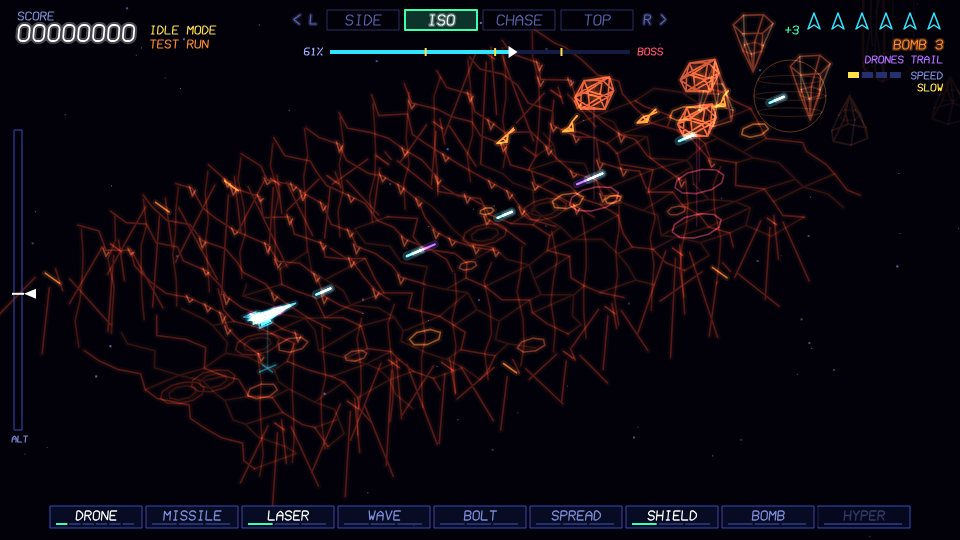

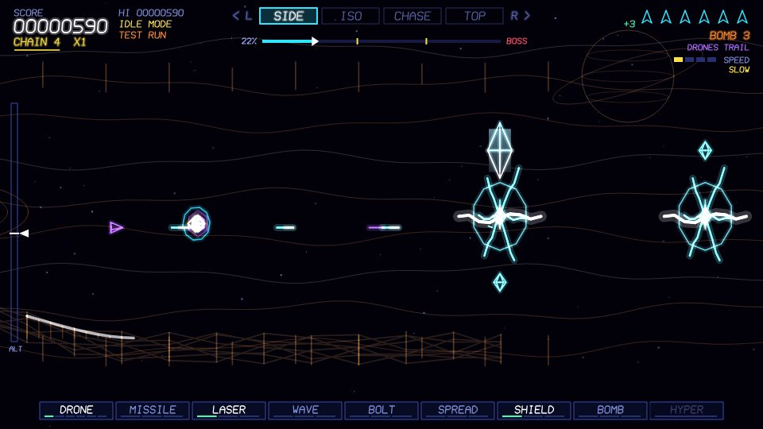

### 28. The boss health bar is back (r35)
- When the bosses were moved further back in r29, the boss health bar and the weak-spot marker were still waiting for the boss at its old distance, so neither ever appeared. Both now show again and the bar drains as the boss takes damage.

### 29. Arena warps, a map that keeps score, and calmer lava (r36)
- **Arenas are found, not handed out.** A planet's bonus arena no longer follows its boss. Each level now hides a second warp, a gold one with no announcement, a little after the first checkpoint. Fly into it from CHASE view and you fight the arena; win or lose, you are dropped back at the next checkpoint of the level you left.
- **Space stations on the solar map.** Each arena is a small station tethered under its planet, shown as a question mark until you find its warp. The ship flies to it and back on the map, the same as for the other bonus stages.
- **Ticks and grades.** Cleared planets get a green tick and their rank on the map; cleared bonus stages and arenas get a tick.
- **The lava tide rolls.** The rising lava and falling ash in THE COLOSSUS fight now have a proper wave running along the surface and through the layers beneath it.
- **No more lava lines.** The flickering lines over the nearby volcanoes are gone. Far-off volcanoes now spit blobs of lava that arc up and fall back.

### 30. The ground is not flat (r37)
- **Hills, slopes and ramps.** Every planet now has stretches where the ground rises, levels off and falls away: overpasses and embankments on Earth, dunes and ridges on Mars (one runs through the cave), swells in Jupiter's cloud deck, mounds of tissue on Planet X.
- **The ship rides over them.** A hill does not kill. It lifts the lowest height you can fly at, so there is less room under whatever is overhead. Ground troops stand on the slope.
- **The floor follows the slope** in every view. Side on, a hill is a bright ridge line with hatching beneath it.

### 31. Boss rush (r38)
- **A new mode in the PLAY menu.** Twelve fights back to back: each planet's boss, then its arena miniboss, then its warp-stage miniboss, from OVERSEER to FROST WARDEN. No results screens, no map and no story in between.
- **How it starts each fight.** Planets begin at the checkpoint just before the boss, bonus stages just before their miniboss, and arenas skip their waves. You start with a modest loadout and five ships, and carry upgrades, ships and score from fight to fight. Here a hit in a bonus stage costs a ship like anywhere else, not the whole stage.
- **Score and time.** A clock runs while you play and shows in the HUD with the fight number. The end screen gives fights won, time and score, and your best run is kept and shown in the PLAY menu. Beating all twelve unlocks a new achievement, GAUNTLET.
- Also fixed: the WEAPONS LOST callout when you lose a ship had been silently switched off by a stray comment.

### 32. Extra ships (r39)

- **1UP pickups.** Enemies now sometimes drop an extra ship: a small green ship turning inside a purple ring with a plus sign beside it. They are rare, but one is always due after enough kills, so every level should show at least one. Picking it up adds a ship (up to nine) with a "1UP!" callout; at nine it pays 5000 points instead.
- **Ship counter.** The HUD still shows six ship icons, with a "+N" beside them when you hold more.

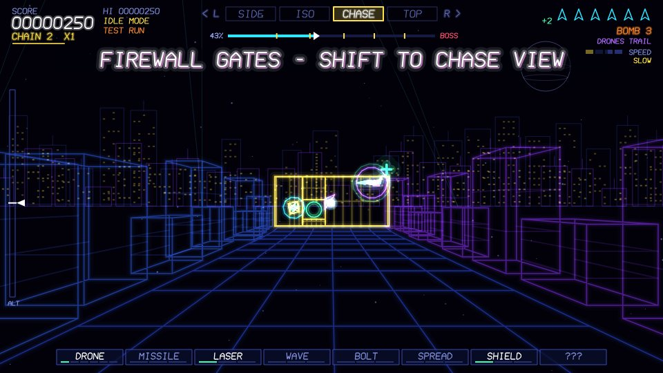

### 33. Bomb upgrades, a bigger playfield and two ship skins (r40)

- **Bombs upgrade.** The power-up bar has a new BOMB slot with three tiers, so spare pods have somewhere to go. The basic bomb is now a short burst around the ship. Tier 1, SWEEP BOMB, is a rectangle that rolls out from the ship over a much bigger area. Tier 2, SCATTER BOMB, sets off eighteen diamond blasts across the screen, half of them on enemies. Tier 3, MEGA NUKE, pulls everything in for half a second and then takes out the whole screen. The tier survives losing a ship, like drones do.
- **More room.** The camera is in effect 30% further back with the levels 30% bigger to match: the ship, enemies, shots and pickups are all drawn and collide about a quarter smaller against the same level layouts. Gaps, lanes and gates are that much roomier and buildings that much taller next to the ship. Drone formations, the wingman and the idle-mode pilot were resized to match.
- **Taller skyline.** Earth's opening run has taller and more varied towers, with blocks hanging from above where the tower below is short.
- **Hit flash.** The red flash on enemies and bosses strobes slower and lasts longer, so it reads as a flash when you are pouring fire in.
- **Ship skins.** OPTIONS has a SHIP SKIN setting. FIRE MAGE turns the ship into a firebat with flapping wings and embers, and every weapon into fire: flame darts, a wavering stream of flame, fireball missiles, ember drones. DARK LORD is a wraith stealth ship trailing a ragged cloak, with shadow bolts, a violet beam, soul-green lightning and wisps for drones. Skins only change the look. FIRE MAGE unlocks by beating the second boss and DARK LORD by beating the last one; the options menu previews a locked skin on the title screen.

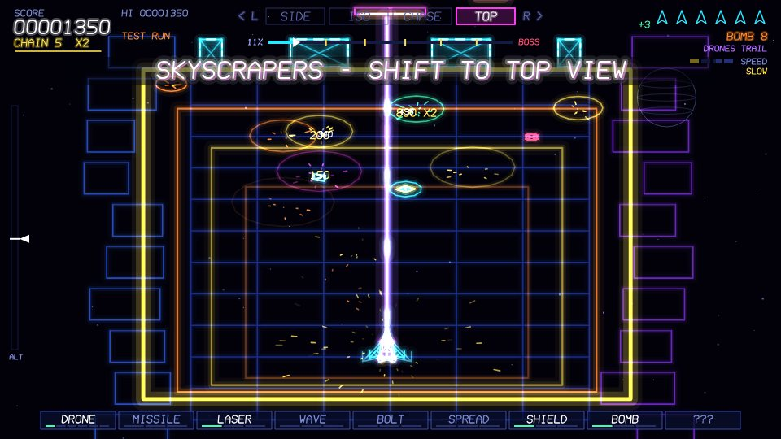

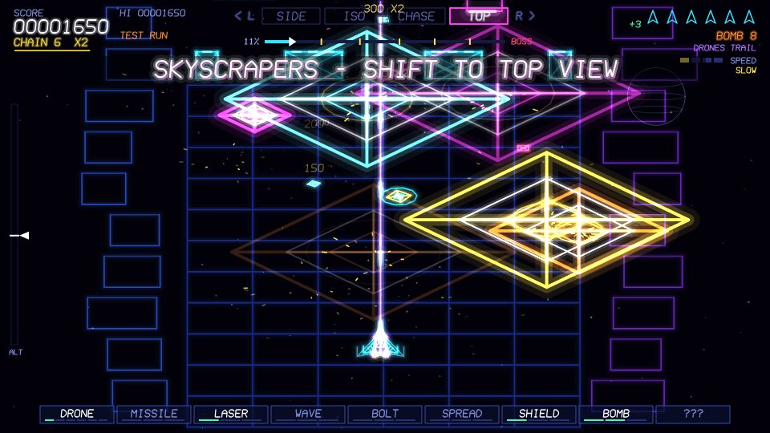

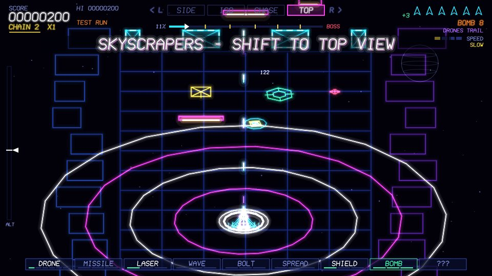

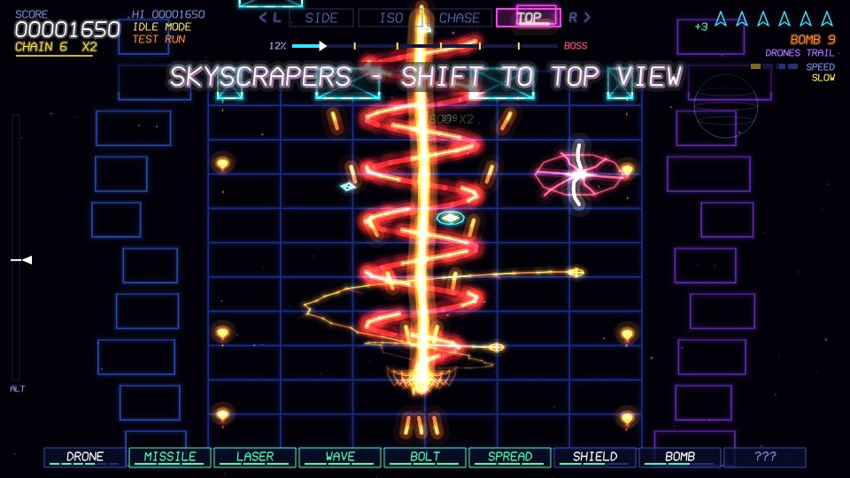

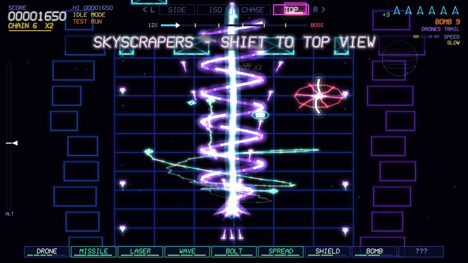

### 34. Seeing further, hyperdrive and set-and-forget bombs (r41)

- **See further ahead.** The last pass made room around the ship but showed no more of the level ahead, which was the point of asking. Now the distance ahead is squeezed on screen by the same 30%, so about a third more of the level is in view in every view, and the ship can fly a third further up it. Enemies and scenery are placed that much further out so nothing appears inside the picture. Ships, enemies and rings are stretched back so they keep their shape. Boss fights and arenas keep their own camera.
- **Hyperdrive.** The wildcard slot at the end of the bar is gone. In its place is HYPER, which stays locked until drones, every weapon and the bomb are maxed. One pod then switches hyperdrive on for good: 15% more damage from everything, kept when you lose a ship, and the ship glitters while it is on.
- **Auto detonate.** A new option sets off a bomb every ten seconds for as long as you have one.
- **Back to slow.** Losing a ship drops the speed back to SLOW, so the next one is not thrown straight into traffic.
- **Red targets.** The target marker on the next enemy in a wave is red now; in yellow it looked too much like a pickup.
- **Skins in the store.** FIRE MAGE and DARK LORD can now also be bought with Sparkz in the site's store, as well as earned by beating the bosses.

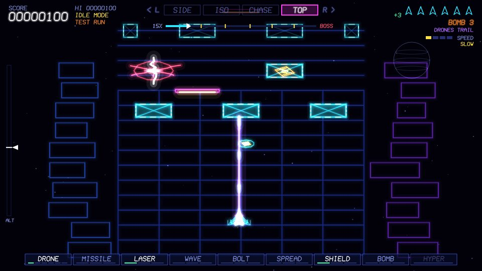

### 35. A bug test checklist (r42)

- **BUG TEST.** The title menu and the pause menu have a BUG TEST checklist: every planet, warp stage and arena, Boss Rush, and the ending with its loop. Picking one starts you there with no damage: hits are marked on screen and counted, but nothing is lost, so the weapons and upgrades behave as in a real run and you buy them by hand. Planets start with roughly the loadout you would have by then. Clearing one ticks it off, and the list is kept between sessions.
- **Clean test runs.** Test runs never post scores and do not unlock achievements, skins, medals, ghosts or Boss Rush records.
- **One switch for release.** When the list is done, a single flag hides the checklist and the solar map's level-jump test buttons together for the jam build.

### 36. A new voice (r43)

- **The announcer is a woman now.** A calm, close, unhurried voice, picked from the best female voice the browser offers, a little lower and slower than normal speech.
- **Title voiceover.** The title screen says the name: "two-diso ... shift".
- **ISO is a word.** The announcer used to spell out I-S-O; it now says "eye-so", like the rest of us.

### 37. Test tools: any skin, any loadout (r45)

- **Skin picker in BUG TEST.** Wear any skin for testing, locked or not. It only works while the test menu exists, so it goes away with it.
- **Loadout manager in BUG TEST.** Set drones, each weapon, bomb tier, hyperdrive, shields, bombs and ships by hand; every test, Boss Rush included, starts with that loadout. MAX EVERYTHING and EMPTY are one press each.
- **A shorter pause menu.** Idle mode and the RIVET-9 assist only live in OPTIONS now.

### 38. A new logo (r46)

- **A display face of its own.** The title logo is no longer set in the in-game font. It has its own geometric letters, built from chamfered strokes with a dark keyline, a hot core and a chrome gradient. 2DISO leans a little in cyan and blue; SHIFT leans hard in pink and violet.
- **SHIFT is sliced.** A seam runs through SHIFT and its top half sits shifted sideways, as if the view was caught mid-roll. Every couple of seconds it jolts further.
- **New tagline.** "Shift the view. Shift the rules."

### 39. Pill buttons, a fifth speed and a fairy (r47)

- **Menus look like the site.** Menu items are neon pill buttons, as on ArcadeGridz and in the app: a cyan outline at rest, the chosen one lit amber and lifted. Option rows show their left and right arrows inside the lit pill. The title menu floats over the attract run with no box behind it, and other menus sit on a soft rounded glass card.
- **A bolder menu font.** Menu items and titles use a new bold style of the vector font: thick strokes, corners cut square instead of rounded, a bit more lean and more room per letter.
- **HYPER.** A fifth speed above TURBO, for going very fast.
- **The god-mode beam reaches the far edge** of the bigger field again, and so do the laser and the drones' beams.
- **The wave hits harder** (about half as much again at every rank), and its top rank is gold so it no longer looks like rank 2. The skins got the same fix.
- **The title voice says it right:** "two-DIE-so", a beat, then "shift".
- **A cooler tagline.** Under the logo it is now bold and in two colours, "SHIFT THE VIEW" in cyan and "SHIFT THE RULES" leaning in pink, with a lit chevron between them and brackets either side.
- **PIXIE skin.** The ship becomes a fairy: a glowing body, four butterfly wings that flutter, antennae and a falling trail of glitter. Shots become twinkling stars, missiles little spinning stars, drones fireflies, and every beam and wave turns pastel. Beat the Eye on Jupiter to earn it, or buy it in the Sparkz store.

### 40. Red fog, gas clouds and a hyper run (r48)

- **The Sun, rebuilt.** The solar panels are gone. The Sun's atmosphere is now thick red plasma fog with one clear winding channel through it; stay in the channel to stay cool. Solar flares are bigger, with five twisting strands, bright knots and glowing feet.
- **Jupiter's gas clouds.** Big clouds drawn as a fine wavy mesh drift by slower than the level, so enemies and obstacles slip behind them for a moment.
- **Jupiter recoloured and longer.** Greens, purples and fuchsia instead of brown, more enemies everywhere, and a new chase section, THE DEEP, full of sharks and jellyfish to dodge.
- **Mars eruptions** are now columns of fire instead of lines.
- **Planet X hyper run.** A section near the end locks you at HYPER speed. Walls flash where they are about to appear, then turn solid.
- **Warnings.** Some enemy waves flash on screen just before they arrive, and the gold warps now come with an ANOMALY DETECTED call and a hint, plus a slightly bigger catch area.
- **Bosses** call in waves of their level's enemies during the fight, and in chase view they are drawn bigger so you can see their faces.
- **Solid enemies.** Every enemy has a shaded body behind its outline, so nothing is just a pair of crossed lines any more.
- **More hills and ramps** on every planet, and the bonus stages lean on chase and iso views.
- **Smoother.** Quality steps down sooner when frames slow down and comes back once things settle.

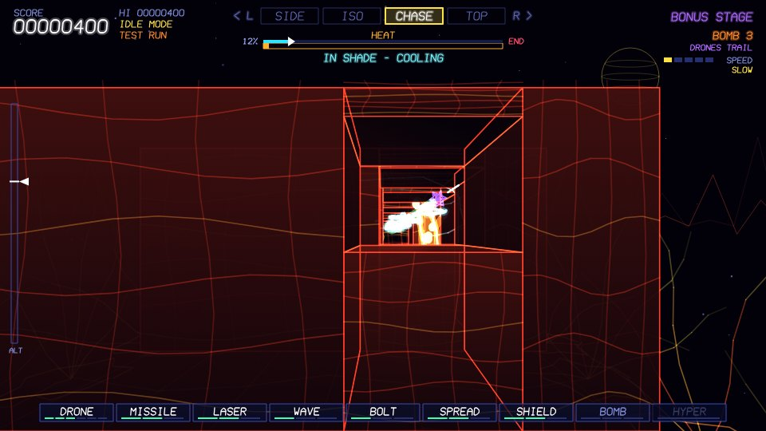

### 41. Ragged holes and real boulders (r49)

- **No more square holes off Earth.** In chase view a gate on Mars, Jupiter or Planet X is now one wall of rock, cloud or flesh with a ragged rounded opening, a tunnel rim, and cracks, ripples or veins spreading out from it. A soft green rim inside marks the way through. The opening is drawn slightly inside the real gap, so the edge never kills you before it looks like it should. Earth keeps its square building gaps.
- **The Sun's fog** is drawn the same way in chase and iso: slice after slice of red fog with a rounded hole for the channel.
- **Rocks look like rocks.** Rocks on every planet bulge in the middle and taper front and back instead of being extruded blocks, with round shaded lobes instead of box fills. The Moon trench is now a ragged line of boulders of different sizes instead of a row of cubes.

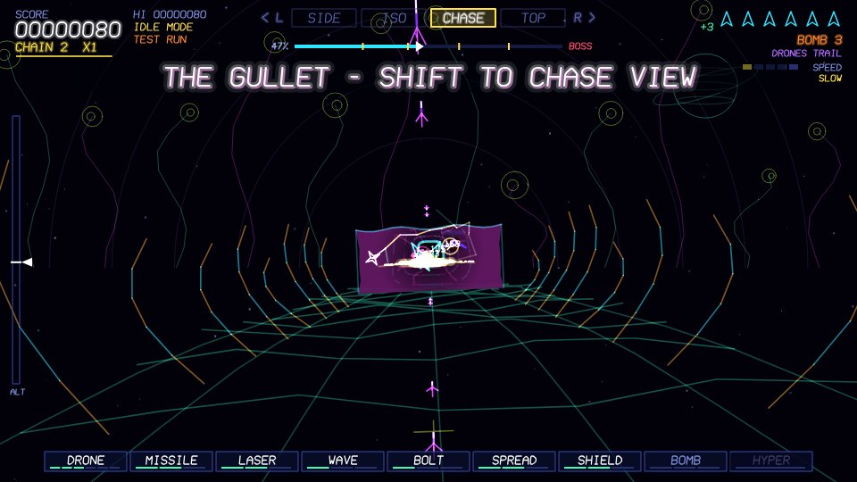

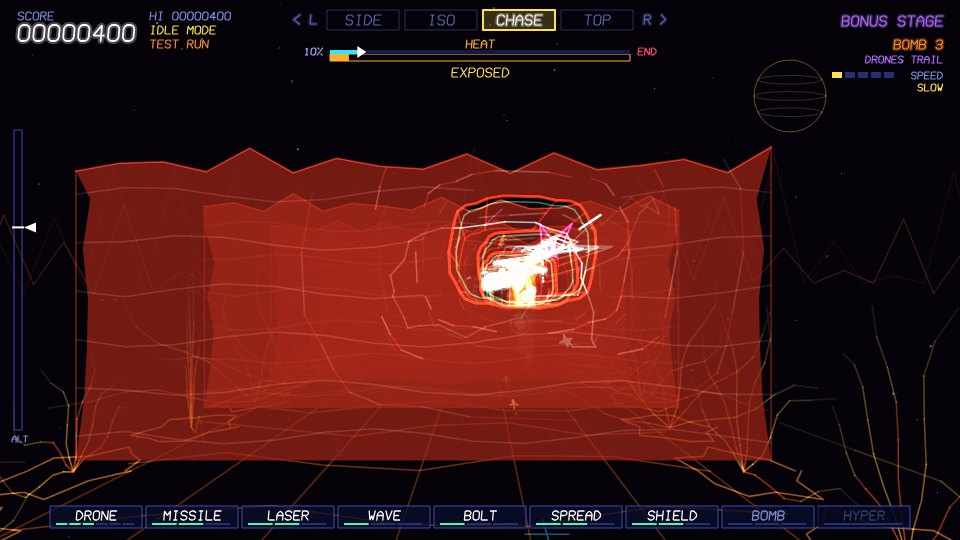

### 42. RIVET-9 on comms (r50)

- **Tips come from RIVET-9.** View calls, hazard tips and anomaly alerts now pop up as a little instant-message window in the top left, with his portrait, a title bar and the text typing out. It stays up long enough to read, fades away on its own, and he reads it out loud. If a second message comes in, the first slides down and fades.
- **He overreacts, on purpose.** His face is an emoji on a visor and changes as he talks: shocked then starry-eyed at an anomaly, panicking with a sweat drop at lava, sharks and lightning, angry eyebrows at a boss, a smug grin when it's time to shift. His mouth flaps while the words come out, he shakes when he's scared, and every message opens with WHOA!!, YIKES!, GET HIM! or OOH!
- **The big calls stay big.** Stage names, waves and other headline calls stay as centre-screen banners, now in the thick bold font along with the level titles, results screens, boss names, warnings and score pop-ups.

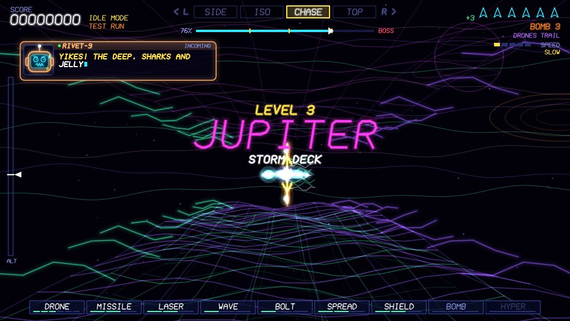

## Day 3 — Fri 13 Nov 2026

### 43. Warps you have to mean (r51)

- On Earth the arena warp could still be hanging around when the level asked you to shift to chase view, so you could fall into it by accident and skip a good stretch. Every warp now appears in a stretch that isn't played in chase view, and closes before the next chase stretch, so taking one is always a choice.

### 44. Boss rush warp stages fixed (r52)

- In boss rush the four warp stages said complete straight away. Boss rush dropped you in just past the point where the miniboss is called in, so it never came. Boss rush now looks up where each stage's miniboss arrives and starts you just before it.
- The red HIT markers from bug testing are gone. Bug test still counts your hits on the results screen.

### 45. Tabs, surprise shifts and tougher blob walls (r53)

- **Options in tabs.** SOUND, VIDEO, PLAY, SHIP and MORE. Flip tabs with L / R, or left / right on the tab row.
- **Reality shifts in the levels.** The fold now flips your view for you once or twice on every planet, not only in the last boss fight. Where it happens is random each run, but always somewhere in the middle half of the level and never right on a change of view. Roll back yourself.
- **The last boss's blob walls hold.** They have more than ten times the health and scale with your guns, so it now takes a few seconds of focused fire to burst one before it reaches you.

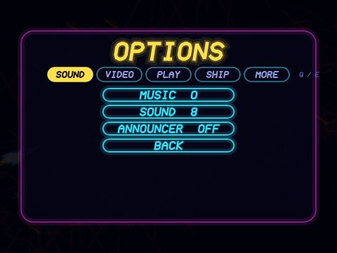

### 46. Cutscenes between planets (r54)

- **A short flight between planets.** After each boss, before the map and hyperspace, there is a short scene. The world you saved slides away behind you, the next one looms up with the rift cracked across it, and you fly with RIVET-9 tucked in behind. He talks you through it on comms, with his face doing the acting: proud, then panicking, then fired up.
- **RIVET-9 calls the reality shifts** in the levels and in the last boss fight, with a WHOA WHOA WHOA! and a shocked face.

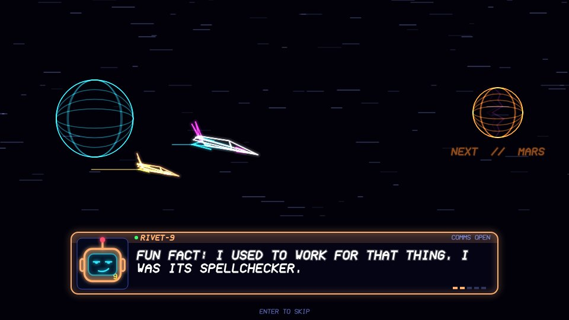

### 47. A story between the planets (r55)

The cutscenes now tell a story, five lines each, and it carries through to the ending:
- **Earth to Mars.** RIVET-9 used to work for OVERSEER (he was its spellchecker). Before it crashed it sent one word to Mars: WAKE. The stone heads there are not statues. They are antennas the Fold listens through.
- **Mars to Jupiter.** THE COLOSSUS talked on the way down: the Fold cannot see depth and only ever sees one side at a time. That is why it hates a pilot who sees all four. So it grew an eye inside Jupiter.
- **Jupiter to Planet X.** RIVET-9 pulls coordinates out of the Eye's last look. Planet X is not a planet. It is a dream that something far past Pluto is having, and the only hope is to break the dream so the dreamer stays asleep.
- The ending's last line now points back at the dreamer. Each line also stays on screen longer, so the whole thing can be read and heard.

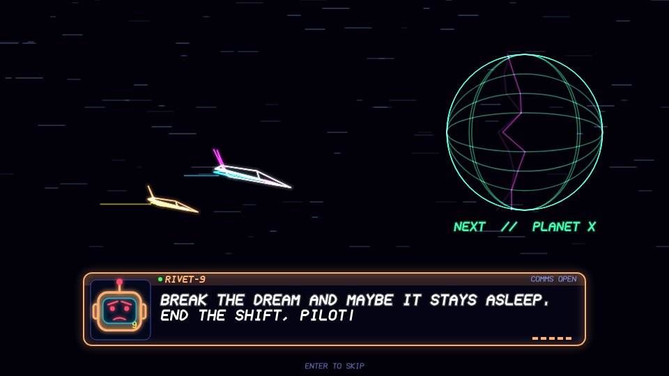

### 48. A jam banner on the title screen (r56)

- The Game Off note on the title screen is now a neon pennant hanging in the top right corner: GITHUB GAME OFF 2026, THEME: SHIFT and a DEVLOG button. It sways, glints and glows brighter when you point at it. Click or tap it, or press the drone button, to read the devlog. The DEVLOG item has left the title menu.

### 49. Skin previews (r57)

- The SHIP tab in Options now shows the skin you are looking at as a turning model, with dots for all four skins. A skin you have not earned is a dim silhouette with a padlock, plus what unlocks it: beat the boss, or the Sparkz price from the store (FIRE MAGE: THE COLOSSUS or 500, PIXIE: THE EYE or 650, DARK LORD: THE SHIFTER or 800).

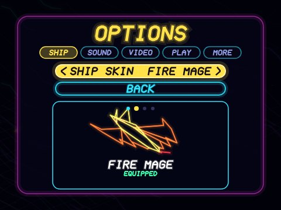

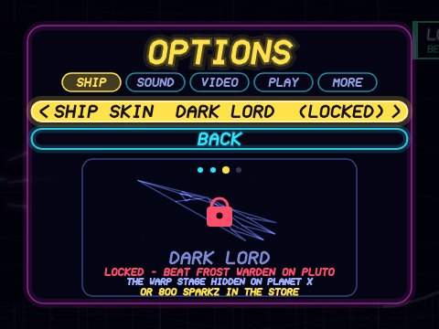

### 50. Skins drop from the warp stages (r58)

- **A reason to find the warps.** Skins no longer come from the main bosses. Each one drops from the miniboss of a hidden warp stage: FIRE MAGE from SOLAR FLARE on the Sun (warp on Mars), PIXIE from THE MOTHER ROCK in the Asteroid Belt (warp on Jupiter), DARK LORD from FROST WARDEN on Pluto (warp on Planet X). You can still buy them with Sparkz.
- **The music slider works.** Each sound bus used to go into one shared compressor that evened the volume back out, so turning the music down barely changed anything. Music and sound effects now each have their own compressor, the sliders come after it, and a limiter at the very end only catches peaks.
- **SHIP is the first options tab.**

### 51. A cleaner, smoother title screen (r59)

- **Smooth title.** No game plays behind the title any more. The backdrop is now a slow starfield over a rolling neon grid floor, with a pink glow on the horizon, and it costs almost nothing to draw. In a test it went from about 15 to 55 frames a second.
- **New layout.** Your ship turns in the middle of the screen in the skin you have equipped, and the menu sits under it in two centred rows.
- **BUG TEST** has moved out of the title and pause menus into Options, on the MORE tab.
- **The title voice says the whole name again.** In some browsers a line spoken straight after another one was cut gets dropped, so the 2DISO part was being lost and only a rushed SHIFT came through. The title is now one slower line with a real pause in the middle.

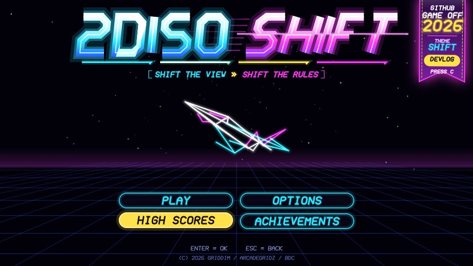

### 52. A devlog you can actually read (r60)

- **Entries fold up.** The in-game devlog used to be one long wall of text. Now every entry is a single line until you open it, and only one is open at a time. Tabs along the top split it into the backstory, each day of the jam and the to-do list, and the screenshots from this page appear inside the entries they belong to.
- **The DEVLOG button is back on the title menu,** on the second row between ACHIEVEMENTS and EXIT. The jam banner in the corner is now just a banner.

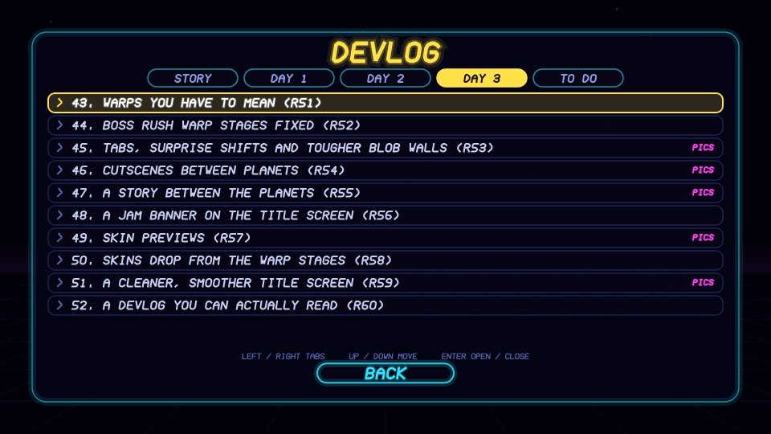

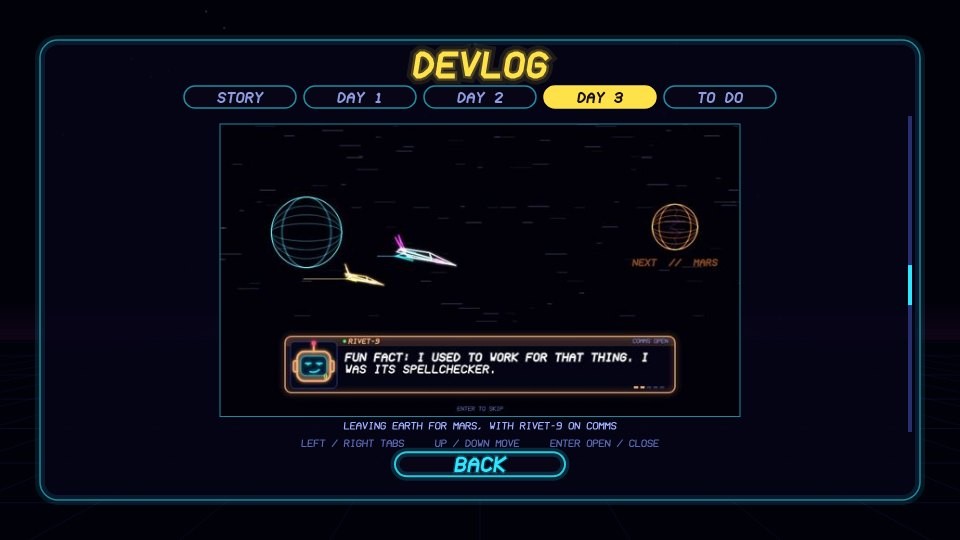

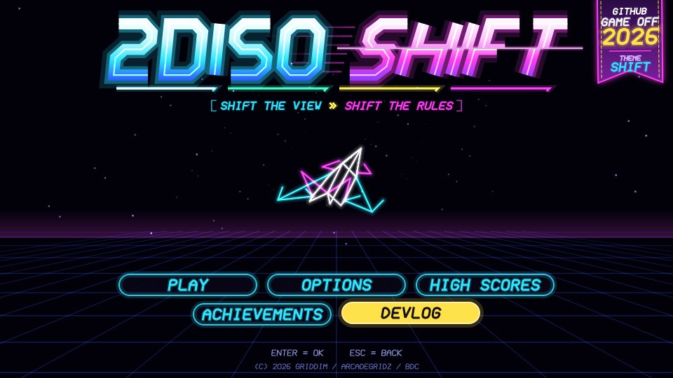

### 53. Ice, land and better crawlers (r61)

- **Pluto rebuilt.** It was the dullest stage. Now the ice shelf has icicles hanging over it, the chase stretch throws snowflake comets at you (six-armed flakes with long icy tails) between cryo geysers that blast columns of ice crystals, icicles hang from above and spikes grow from below, and the last stretch is a field of drifting icebergs in iso view. Snow falls the whole way.
- **No more boxes round spikes.** Rock spikes and icicles used to sit inside a shaded box that ran right up the point. They are now filled face by face as cones.
- **Eruptions without the glitch.** Lava geysers, in the level and in THE COLOSSUS fight, used to flash a box while they built up and stand in a box once they blew. Now a ghostly column of rising rings marks where one is about to go, and the eruption is just fire.
- **Crawlers.** The ground walkers were a ball on four sticks. Now they are six-legged armoured mech crabs with a domed shell, a red eye that tracks you and twin guns, stepping in two sets of three. They are a bit bigger and turn up more often, in pairs.
- **Earth stands on land.** The city floor used to be a grid over open space with stars showing through. Now it is solid ground: an asphalt road with kerbs, lane lines and zebra crossings, and street lamps along both pavements.

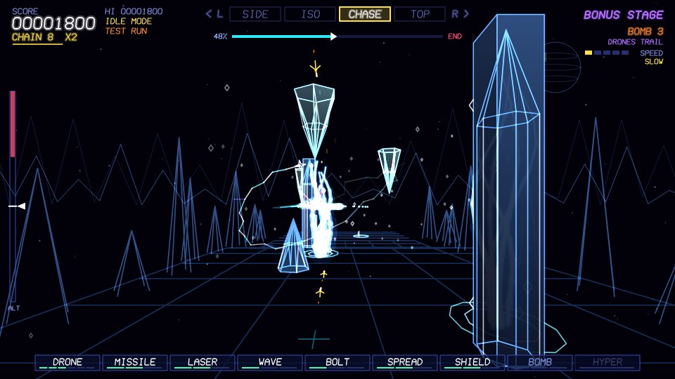

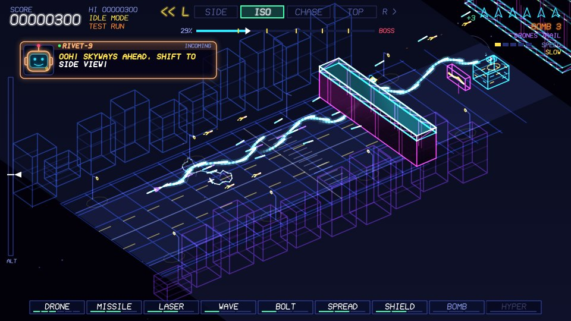

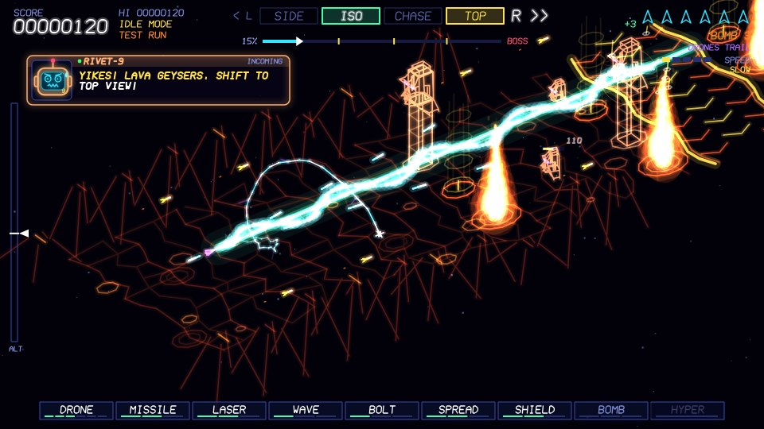

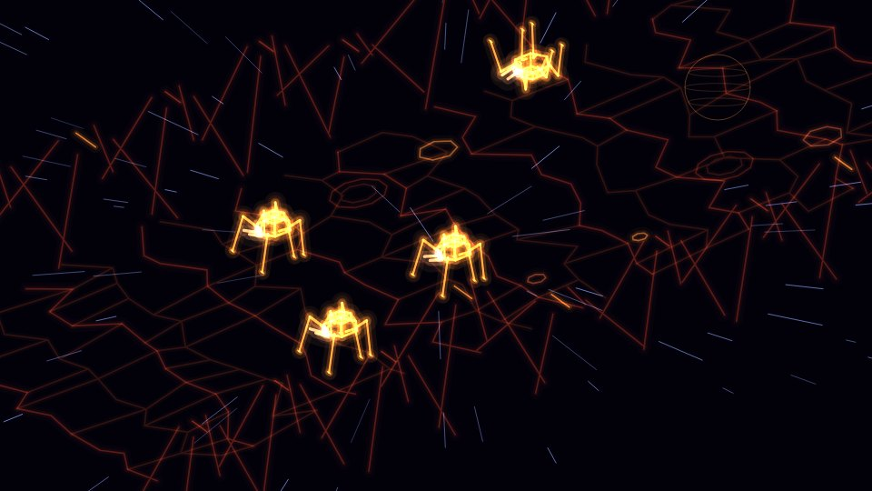

### 54. Blob walls you can read (r62)

- THE SHIFTER's blob walls cycle through the rainbow, flash solid red every time you hit them, and carry a health bar that goes from green to yellow to red. The red and the bar keep their true colours even on the trippy planet, where everything else shifts hue.

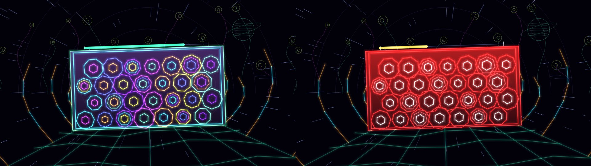

### 55. Tougher minibosses, a fuller bug test (r63)

- **Warp-stage minibosses last.** LUNAR SENTINEL, SOLAR FLARE, THE MOTHER ROCK and FROST WARDEN went down in about three seconds, too fast to see what they do. They now have four times the health: around 12 seconds with maxed guns and 15 to 20 with weak ones. The arena champions get half again as much.
- **Bug test: every boss on its own.** The list now has all four bosses and all four warp-stage minibosses as separate entries. Each one drops you in just before the fight and ticks off when you win it.
- **Bug test: no warps.** Bug test runs of the planets no longer spawn warps, so you can't fly into one by accident and leave the level you are testing.

### 56. Room to fight (r64)

- Warp-stage minibosses used to park close in front of you, leaving little room to back off. They now come in from further away and hold well up the lane, so there is space to dodge and fight.
- The pop-up cards in the corner grow to fit their text. A long one, like the tick for the MOTHER ROCK test, used to spill out of its card.
- On the Sun the heat meter drops below a boss or miniboss health bar instead of sitting on top of it.

### 57. Smooth first: graphics settings and dynamic framerate (r65)

A proper look at where the time goes. The answer was clear: the game logic costs almost nothing (about a quarter of a millisecond a frame). Nearly all of a frame is spent painting glowing lines, and the cost grows with how many pixels there are and how many times each line is painted.

- **GRAPHICS: HIGH / NORMAL / LOW** in Options, VIDEO tab. HIGH is the full look. NORMAL keeps the glow but softer, at three quarters of the resolution. LOW has no glow, half the resolution and no far skyline; it is plain but sharp and readable.
- **DYNAMIC FRAMERATE** (on by default). It watches the frame time while you play. If frames run long it drops a step within a second, faster if things are really bad, and climbs back after ten smooth seconds. If it climbs and has to drop again straight away, it waits twice as long before the next try, so it does not bounce. There is one emergency step below LOW that only this can reach. The option shows the step it is on.
- **Cheaper glow at every setting.** The halo round each line used to be painted twice at full size. Now the glow is painted once into a small off-screen buffer and laid over the picture, and the wide outer halo is that same buffer shrunk and stretched. It looks the same and takes one pass fewer per colour.
- **Cheaper text** on the lower settings: the neon halo on HUD text goes first.

On a test machine with no graphics card at 1080p, the same Mars stretch went from 29 frames a second on HIGH to 44 to 48 with dynamic framerate on.

### 58. Everything goes through RIVET-9 (r66)

- No more centre-screen banners. Sector names, waves, minibosses, boss kills, LAVA RISING and the rest now all arrive in RIVET-9's comms window, each with its own opener and face (HERE WE GO!, INCOMING!, UH OH!, YES!!).
- Flashing status warnings moved there too: overheating, flying over lava, a shielded boss core, leaving the clear channel on the Sun and the arena's view call. He says each one once when it starts instead of it flashing in the middle of the screen. The gauges keep a short plain label.
- The heat meter no longer sits on top of the level progress bar.

### 59. Clarity mode (r67)

- A new CLARITY switch under VIDEO for when the screen gets busy. The backdrop dims, your own shots, beams and explosions turn translucent, particles and score pops are capped, and enemy bullets always draw on top with a dark backing so they stay readable through everything.
- Left: normal. Right: clarity on. Top is the Mars boss in TOP view, bottom is Planet X in SIDE view.

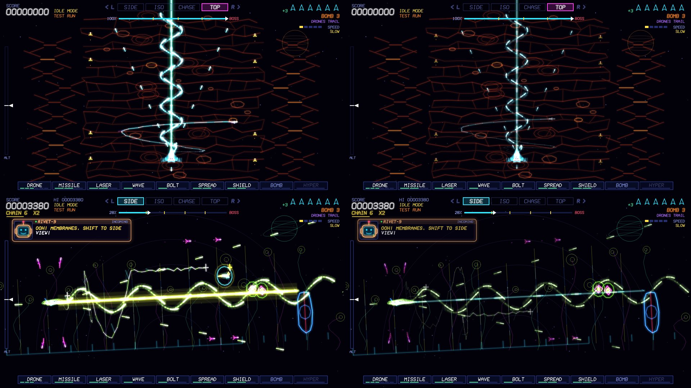

### 60. Six ranks for everything (r67)

- Every weapon, the shield, the bomb and the hyperdrive now have six ranks, the same as drones. The old top ranks are still the top; the new ones in between each add a twist instead of just more damage.
- MISSILE: Sparkler, Swarm, Shrapnel (hits throw shards), Barrage, Tagger (marked enemies take more damage), Cluster.
- LASER: Penlight, Focus, Mirror (the beam eats bullets), Lance, Capacitor (every fifth pulse hits hard), Prism.
- WAVE: Ripple, Wide, Echo (a mirrored second wave), Tidal, Undertow (shoves enemies back), Tsunami.
- BOLT: Static, Fork, Magnet Coil (pulls pods in), Chain, Blackout (clears nearby bullets), Storm.
- SPREAD: Double Tap, Twin Fan, Piercer, Star Fan, Railgun, Nova Fan.
- SHIELD: Film, Barrier, Blowback (losing a layer knocks bullets away), Double Barrier, Afterglow (longer safe time after a hit), Triple Barrier.
- BOMB: Wide Ring, Sweep Bomb, Backdraft (a second sweep), Scatter Bomb, Vacuum (pulls in every pod), Mega Nuke.
- HYPERDRIVE still unlocks only once everything else is maxed: Overclock, Magnet, Quicksilver (faster fire), Second Wind (one free save per level), Bomb Forge (bombs refill slowly), Singularity.

### 61. Small fixes (r67)

- God mode and overdrive countdowns now live in RIVET-9's comms window instead of the middle of the screen.
- Once everything is maxed, pickups stop being upgrade pods. You get the odd bomb, or points.

### 62. The Labyrinth, and tighter pacing (r68)

- Mars has a new stretch between the caves and the magma tubes: THE LABYRINTH, a maze of lava rock seen from above. The forge locks your speed at SLOW the whole way through. One gap in each row is the way on. The other gaps lead into side pockets with gems and pods, sealed at the far end by rock you have to blast through.
- Earth was the longest level by a wide margin, so parts of the skyscrapers, skyways and firewall gates are gone. The construction zone and the hover traffic stay in full.
- Warp stages are shorter: the run up to each miniboss is trimmed, and the minibosses keep their full health. Bonus arenas have smaller waves, so each one takes about a minute.
- The blob walls in the final boss fight have a bit less health.

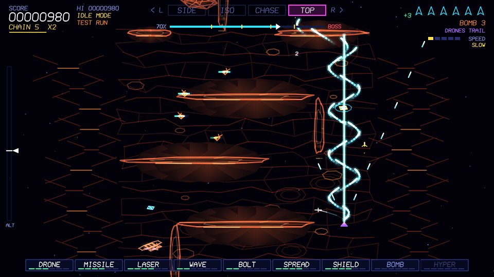

### 63. The Motherlode (r69)

- Halfway through the asteroid belt you now fly into one giant hollowed-out rock with a mining colony inside it, played in SIDE view. The cave roof and floor close in, drill rigs pump up and down, ore carts run along the rails, laser fences guard the seams and the ore crates are full of gems. Mining drones patrol it. After that you're back out among the rocks.

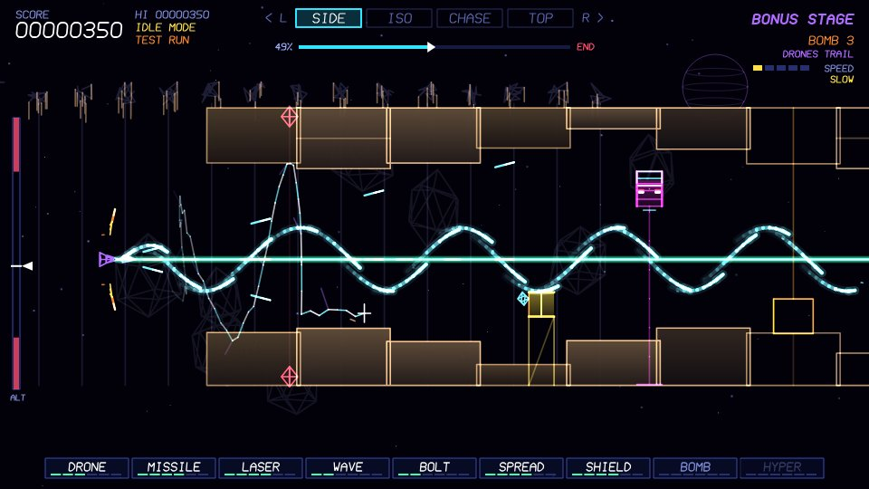

### 64. The stage moves (r70)

- Planet X already rocked the screen a little. Now the whole stage turns, tips, rolls and drifts in many more places, and the controls stay screen-relative: up on the stick is always up on the screen, however the stage is turned.
- Jupiter has a new stretch, THE DESCENT. The deck gives way and the stage turns on its side, so you fall straight down through Jupiter's coloured gas bands, threading gaps in the cloud shelves and lightning, until the storm opens into the sea below. A little of the lightning chains and storm walls came out to make room, so the level is about the same length.
- Mars: the magma tubes roll all the way round as you fly through them.
- Planet X: the fold flips the membranes section upside down, the tentacle forest heaves, and the gullet twists as it carries you along.
- Earth: the street banks and weaves through the hover traffic.
- Warp stages: the Moon trench floats about in the low gravity, the Sun's channel tips nose-down for the dive, and the Pluto blizzard rocks the stage.
- Bosses always fight on a level stage.
- Fixed a bug in the level trimming from r68/r69: scenery after a trimmed stretch stayed where it was instead of moving up with the rest.

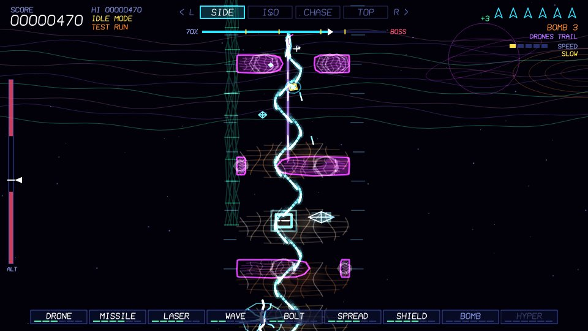

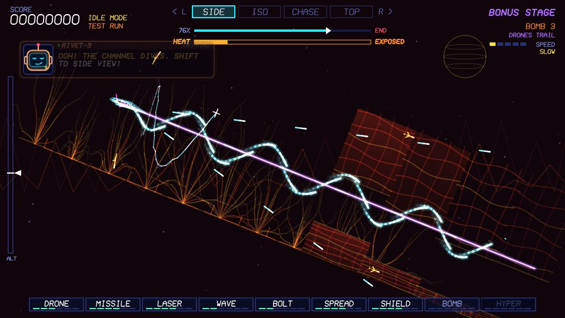

### 65. Smooth from the first second (r71)

- New players now start on NORMAL graphics with dynamic framerate on, on every device. HIGH is still one tap away in VIDEO.
- New RESET TO DEFAULTS under OPTIONS > MORE. Press it twice to confirm. Your chosen ship skin stays.
- Before the playtest: a full sweep through every level, warp stage, arena and boss at every graphics setting, with clarity on and off, plus every menu. Nothing broke.

### 66. The picture breaks up (r72)

- A glitch effect, like an old TV giving out: torn lines, the picture slipping, red and blue splitting apart, static and a rolling band.
- It hits just before a reality shift throws you into another view, briefly when a shield layer pops, and hard when you lose a ship.
- On your last ship with no shield left, the screen starts to glitch on its own, and more often the longer you stay like that. Pick up a shield and it calms down.
- The Shifter attacks the screen itself: between its shells, now and then mid-fight, and in one big burst of static as it dies.
- Invisible wraiths on Jupiter fuzz the signal when they get close.
- Turning SCREEN SHAKE off tones the glitch right down.
- The shield layers around the ship are spaced further apart and only the inner one glows, so you can count them.

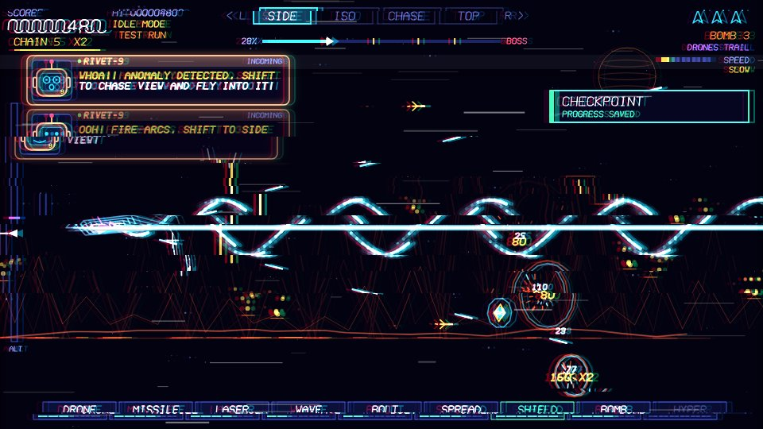

### 67. Shh-shh-SHIFT (r73)

- On the title screen the announcer now says "2diso", then a stuttering SHIFT that echoes away, softer and quicker each time, with a faint electronic ping under each echo.
- The ship swooping in at the end of the intro has a sound now: air building to a roar as it comes at you, then a falling doppler as it peels away.
- Fixed the old drawn GRiDDiM splash flashing up for a moment before the real logo: the intro now shows nothing until the logo image has loaded, and it waits by the clock instead of counting frames, which ran out early on fast monitors.

### 68. Splash sounds and two voices (r74)

- The GRiDDiM splash hums and crackles like a neon sign powering up.
- The ArcadeGridz splash plays a couple of bars of chiptune, finishing on a bright chord.
- The ship's swoop sound starts a little earlier.
- The title line is now two voices: a female voice says "2diso", then a male voice stutters "shif, shif, SHIFT!" and echoes away. The voices are picked once the browser has its full voice list, so the first line no longer falls back to the default voice.

### 69. Tidying the title (r75)

- The text on the jam ribbon is sized to fit inside its dashed border.
- The stutter is now "Sh, Sh, SHIFT!", and it and its echoes are spoken faster.
- Any real click, tap or key press anywhere on the page now switches the sound on. Browsers keep a page silent until you interact with it, and some clicks were not getting through to wake the music.

### 70. Quieter launch (r76)

- The title line is now just a female "2diso", then a male "SHIFT!" echoing away. The stutter is gone: the browser voice kept spelling it out letter by letter.
- The game's own sound now waits about a second after launch before starting, so the ArcadeGridz app's coin-drop sound isn't cut off.

### 71. The title ship flickers (r77)

- Every few seconds, the turning ship on the title screen briefly glitches: torn lines, a red and blue split and a little static.
- The jam ribbon is a little longer, so SHIFT sits clear of its bottom edge.

### 72. The folding world (r78)

- The planet in the opening cutscene keeps folding between dimensions. It turns as a 3D globe, peels flat into a map, tips into an isometric diamond, flattens into a top-down disc, then rolls back into a globe, with a ripple each time it folds.
- Cutscene lines now wait for the voice to finish before the next one starts, so "only one ship can see the fold" no longer gets cut off.

### 73. The Colossus gets a face (r79)

- The Mars boss's eyes were carved on the sides of its head, so in CHASE view you only ever saw a blank stone slab. Now it has a face carved into the front as well: angry brows, burning eyes, a ridge of a nose, and a lava mouth that splits open with teeth of fire when it is about to attack. It is drawn in front of the solid stone so nothing hides it.
- Cutscene voice timing no longer trusts the browser alone: some voices report they have stopped talking when they haven't. Each line also gets a length-based estimate, so lines in the RIVET-9 cutscenes stop getting cut off mid-sentence.

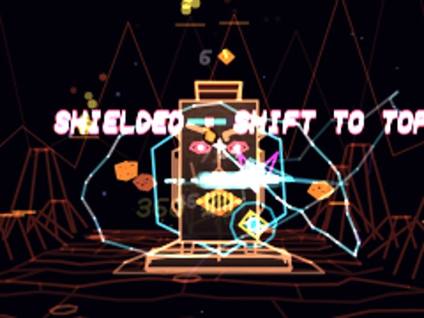

### 74. Ranks that actually climb (r80)

- Fixed a bug from the six-rank change: weapons topped out at their rank-3 strength, so ranks 4 to 6 only added their small twists and never reached the real full power. Each rank now steps up a little, and rank 6 is the full-strength weapon again.
- Every shield rank now adds something: one layer, then longer safe time after a hit, a second layer, BLOWBACK, a third layer, and AFTERGLOW for the longest safe time.
- The Eye on Jupiter has less health. Its lightning walks are shorter, the cyclone pulls more gently and fires fewer sparks, and its storm orbs are softer and shoot less. The pupil's stare comes less often, and its ground strike is one spot with a longer warning instead of three.

### 75. Bosses that match your guns (r81)

- Boss health now scales with your firepower. Each boss's listed health is for a mid-strength loadout, from about 0.8x with hardly any upgrades up to about 1.9x with every gun and drone maxed. A fully upgraded ship no longer melts a boss in seconds, and a ship that lost its upgrades isn't stuck in an endless fight. Minibosses already worked this way.

## Still to do
- Hardware testing: a controller in the ag app, phones, tablets.
- Balance by hand. The autopilot clears everything; people are not autopilots.
- Finish the bug test list, then hide the bug test menu for the jam build.
- Recorded announcer lines instead of the browser voice.
- Push the HTML5 build to itch.io (the page is set up as a draft) and submit it to the jam.
- Retake the itch.io screenshots once the game is final.
